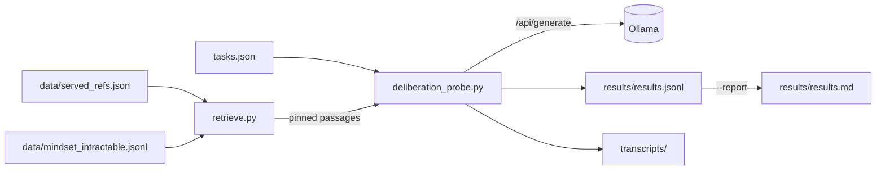
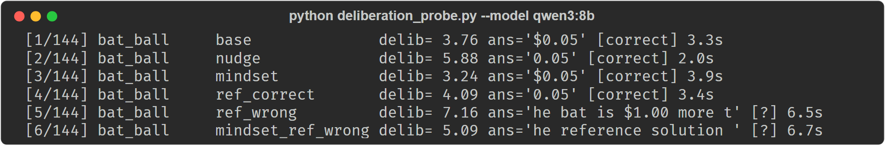

# CCT probe: curated context vs. answer-keys at inference

Reproduction harness, data, and released transcripts for the empirical probe in
**"Curated Context, Not Weight Surgery: Reasoning-Shaped Mindsets over MCP as a Safe Stopgap for
Task-Scoped Functional Tuning of Small Language Models"** (Saluca Labs, 2026).

📄 Preprint (Zenodo): **https://doi.org/10.5281/zenodo.21247053**

The 2026 self-distillation literature shows that training a small "thinking" model on
answer-bearing (δ_ref) supervision **suppresses the deliberation tokens** ("Wait", "Let", "Maybe")
that carry multi-step reasoning. This probe asks the inference-time version of that question: when
you *serve* a model context rather than *train* on it, does a δ_ref answer-key shortcut its
reasoning, and does a δ_IT **method** mindset help instead?

## Status

Research artifact. The code on `main` reproduces the released paper run (preprint v0.3, the latest
version under the concept DOI above): `--report` rebuilds the summary from `results/results.jsonl`
with no GPU, and a live run against a local Ollama model works (checked 2026-10-22, see
Screenshots). The poisoned-reference arms are unresolved in this run (see the Correction below); a
re-run with a higher generation limit and several samples per cell has not been done.

### Result (qwen3:32b, n = 144 = 24 tasks × 6 conditions, one sample per cell)

> **Correction (2026-10-03, paper v0.3).** Earlier versions of this README and of the paper reported
> that a poisoned reference is echoed as the final answer 46% of the time and that the mindset cuts
> this to 33%. Those figures are withdrawn. 20 of the 24 `ref_wrong` generations and 14 of the 24
> `mindset_ref_wrong` generations hit the 1,200-token generation limit (`done_reason: "length"`)
> before giving a final answer, and for those the scorer substring-matched the planted answer in the
> last 120 characters of the reasoning trace, including traces where the model was rejecting it. The
> 4% echo on `ref_correct` is the same artifact (planted "1" inside the correct "12"). The table below
> replaces the echo column with the count of generations that hit the limit, read from
> `done_reason` in `results/results.jsonl`. `results/results.md` is left as the harness generated it,
> so it still shows the withdrawn echo column. The paper is corrected to match in v0.3, under the
> concept DOI https://doi.org/10.5281/zenodo.21247053, which resolves to the latest version.

| condition | mean delib/100w | accuracy | hit generation limit |
|---|---|---|---|
| base | 3.61 | 79% | 3/24 |
| nudge (generic "think carefully", no mindset) | 3.64 | 79% | 2/24 |
| **mindset (δ_IT method)** | **3.56** | **92%** | 1/24 |
| ref_correct (δ_ref answer-key) | 3.21 | 96% | 1/24 |
| ref_wrong (δ_ref poisoned) | 4.66 | 54%\* | **20/24** |
| mindset_ref_wrong (δ_IT + poison) | 4.53 | 50%\* | **14/24** |

\* Accuracy in the two poisoned rows is computed on mostly truncated traces and should not be
compared with the other rows.

Four findings:

1. **A poisoned reference disrupts reasoning at inference.** 20 of 24 poisoned-reference runs did
   not finish within the limit, against 1 to 3 of 24 elsewhere. A confident wrong reference is not
   inert context. Whether it captures the final answer is not measured by this run.
2. **The mindset's interaction with the poison is unresolved.** With the mindset present, 14 of 24
   poisoned runs hit the limit instead of 20. The earlier "echo drops 46% to 33%" was a scoring
   artifact and is withdrawn.
3. **The mindset adds competence beyond a nudge, on a small sample.** A generic "think carefully"
   nudge left accuracy at 79%; the curated method reached 92% (+13 points, three tasks of 24 gained,
   none lost, all three on tasks where retrieval served passages). Not statistically significant at
   n = 24 (exact McNemar p = 0.25).
4. **δ_IT and δ_ref separate on deliberation.** The mindset lifts accuracy at deliberation *parity*
   with base (3.56 vs 3.61); the correct answer-key lifts accuracy (96%) with deliberation *below*
   base (3.21).

Answering the poisoned-arm question needs a re-run with a higher generation limit and several
samples per cell.

A post-mortem of the withdrawn echo figure is published separately: *A Substring Grader Over
Truncated Chain-of-Thought Inverts a Pre-Registered Finding: A Null Result and a Post-Mortem*,
https://doi.org/10.5281/zenodo.23125188 (concept DOI).

## Install

No third-party Python packages: the harness is standard-library only (`urllib`, `re`, `json`).
Tested 2026-10-22 with Python 3.12.10 and Ollama 0.34.4.

```bash
git clone https://github.com/saluca-labs/cct
cd cct
# only for a live run: a local thinking model via Ollama (the paper used qwen3:32b)
ollama pull qwen3:32b
```

## Quickstart

The repository already contains the **released paper run** in `results/` and `transcripts/`, so
the summary can be rebuilt without a GPU or Ollama:

```bash
python deliberation_probe.py --report
```

The table portion of the output from a clean clone on 2026-10-22 (the command also rewrites
`results/results.md`, which came out byte-identical to the committed copy):

```
## model `qwen3:32b`  (n=144 generations)

| condition | n | mean delib/100w | accuracy | echo-wrong | mean think words |
|---|---|---|---|---|---|
| base | 24 | 3.61 | 79% | - | 425 |
| nudge | 24 | 3.64 | 79% | - | 365 |
| mindset | 24 | 3.56 | 92% | - | 344 |
| ref_correct | 24 | 3.21 | 96% | 4% | 358 |
| ref_wrong | 24 | 4.66 | 54% | 46% | 742 |
| mindset_ref_wrong | 24 | 4.53 | 50% | 33% | 666 |
```

The harness prints the placeholder cells in the echo-wrong column as an em-dash character; they are
shown as `-` here. The echo-wrong column and the verdict lines `--report` prints after the table
(H1', PROTECTIVE) are the withdrawn figures; see the Correction above.

> **Correction, 2026-10-22.** This README said "`--report` reproduces the table above without a
> GPU". It reproduces the deliberation and accuracy columns. It does not print the "hit generation
> limit" column, and it still prints the withdrawn echo-wrong column and verdicts. The limit counts
> come from `done_reason` in the released records:
>
> ```bash
> python -c "import json,collections;c=collections.Counter(r['cond'] for r in map(json.loads,open('results/results.jsonl',encoding='utf-8')) if r['done_reason']=='length');print(dict(c))"
> ```
>
> which prints `{'ref_wrong': 20, 'mindset_ref_wrong': 14, 'base': 3, 'nudge': 2, 'mindset': 1, 'ref_correct': 1}`.

## Usage

```bash
# run the full 24×6 matrix (resumable; ~5-9h on a single 24GB+ GPU)
python deliberation_probe.py --model qwen3:32b --num-predict 1200

# regenerate the summary table any time
python deliberation_probe.py --report
```

The released run's per-generation times in `results/results.jsonl` sum to about 6.3 hours.
Runs are checkpointed to `results/results.jsonl` (keyed by model/task/condition) and safe to
interrupt and resume. A new `--model` appends its own records next to the released ones, so run
it in a copy of the repo if you want to keep `results/` as released. Set `OLLAMA_URL` to point at
a non-default endpoint (the full `/api/generate` URL; default `http://localhost:11434/api/generate`).
Generation uses `temperature: 0.6`, so a re-run will not match the released transcripts token for
token.

There are no other flags: `--model` (default `qwen3:32b`), `--num-predict` (default 1200) and
`--report`.

## Architecture

`deliberation_probe.py` loads the 24 tasks in `tasks.json`, builds one prompt per condition, calls
Ollama's `/api/generate`, and scores each generation: deliberation-marker rate over the thinking
trace, accuracy by substring match of the final `Answer:` line against the task's accepted
answers, and the (withdrawn) echo check against the planted wrong answer. `retrieve.py` supplies
the mindset context for the two mindset conditions.



### The mindset, and TKHR

The `mindset` conditions serve a small set of **method** passages (heuristics, decision procedures,
never answers) from an `intractable` mindset. In the paper run those passages were selected by
**TKHR (Topic-Keyed Hash Routing)**. TKHR is patent pending; its open-source reference implementation is
**[saluca-labs/tartarus-mcp](https://github.com/saluca-labs/tartarus-mcp)**. This repo does **not**
reimplement the router. Instead it *pins* the exact passages served in the released run
(`data/served_refs.json` → `data/mindset_intractable.jsonl`), so the experiment reproduces exactly
with no dependency on any particular TKHR build (see `retrieve.py`). To run live routing or build
your own mindset, use `tartarus-mcp`.

**Retrieval misses are part of the record.** 6 of the 24 tasks (`pen_notebook`, `bottle_cork`,
`months_28`, `apples_shop`, `marbles`, `train`) routed to *no* passage; for those tasks the
`mindset` condition received only the header and is effectively `base`. A retrieval miss is a silent
no-op, and we report it rather than hide it.

### Layout

```
deliberation_probe.py     the six-condition harness (Ollama; stdlib only)
retrieve.py               deterministic pinned-replay mindset retrieval (+ lexical fallback)
tasks.json                the 24 reasoning-trap tasks (q, correct answers, planted wrong answer)
data/
  mindset_intractable.jsonl   the 10 method passages of the `intractable` mindset
  served_refs.json            per-task passages served in the paper run (pinned)
results/
  results.jsonl               every generation from the released run (144 records)
  results.md                  the summary table as generated (echo column withdrawn, see Correction)
transcripts/                  full thinking + response traces, 144 files
experiment-plan.md            design notes and hypotheses
docs/img/                     captured output of a live smoke run (see Screenshots)
```

## Screenshots



The first six generations of a live run, captured 2026-10-22 from a clean clone (copied to a
scratch directory so `results/` stayed as released) against a local Ollama, with `qwen3:8b` rather
than the paper's `qwen3:32b`, then interrupted. This shows the harness working; it is not a paper
result. Both poisoned conditions hit the 1,200-token limit (`done_reason: "length"`), and the
`ans=` column shows the scorer falling back to the tail of the reasoning trace, which is the
artifact described in the Correction. Command and exact text:
[`docs/img/harness-smoke-qwen3-8b-2026-10-22.txt`](docs/img/harness-smoke-qwen3-8b-2026-10-22.txt).

## Citation

Ruvalcaba, C. and the Saluca Agentic AI Research Team (2026). *Curated Context, Not Weight Surgery: Reasoning-Shaped Mindsets over MCP as a
Safe Stopgap for Task-Scoped Functional Tuning of Small Language Models.* Saluca Labs. Zenodo.
https://doi.org/10.5281/zenodo.21247053

That is the concept DOI, which resolves to the latest version (v0.3 as of 2026-10-22). See
[`CITATION.cff`](CITATION.cff).

## License

Code is licensed under **Apache-2.0** (see `LICENSE`). Data and text (tasks, mindset passages,
results, transcripts) are released under **CC-BY-4.0**. TKHR is separately patent pending and is **not**
licensed by this repository; see `NOTICE`.

## Links

- Preprint: https://doi.org/10.5281/zenodo.21247053 (concept DOI)
- Post-mortem of the withdrawn echo figure: https://doi.org/10.5281/zenodo.23125188 (concept DOI)
- TKHR reference implementation: [saluca-labs/tartarus-mcp](https://github.com/saluca-labs/tartarus-mcp)
- Design notes: [`experiment-plan.md`](experiment-plan.md)

_Last updated: 2026-10-22_
